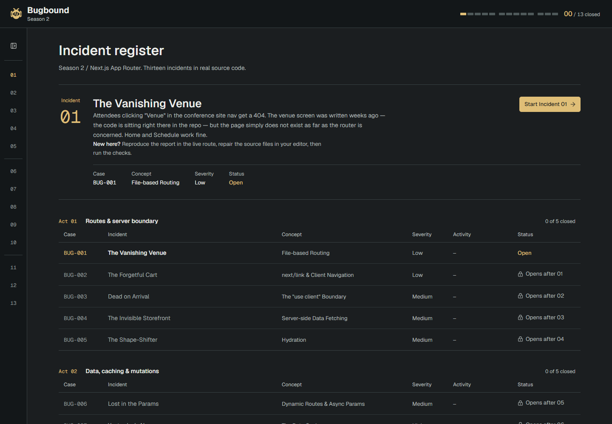

# Bugbound — Season 02

> **Learn Next.js by fixing it.** An investigation desk of 13 intentionally broken Next.js App Router routes — and you're the engineer on call. Again.

Bugbound is a local, editor-first debugging game. Season 02 picks up where [Bugbound Season 01](https://github.com/Brantley-Wyche/Bugbound-Season-1) (core React + TypeScript) left off: instead of mounting isolated components on the client, you work through **13 escalating incidents** (`BUG-001` to `BUG-013`) in real Next.js App Router routes served under `/lab/…`. Each incident teaches one App Router mechanism, hands you a QA-style incident report and a live misbehaving route, and verifies your fix in the browser as Next.js hot-reloads your edits.



> **Desktop-first by design.** Solving incidents requires a local code editor, the Next.js dev server, and a desktop browser running side by side. Phones and touch devices display a setup notice while still allowing you to browse the incident register and lessons.

---

## How it works

Every incident follows the same four-step loop — **Learn · Reproduce · Repair · Verify**:

| Surface | Role in the loop |
|---|---|
| **Docket register (`/`)** | A ruled docket split into **Act 01 — Routes & server boundary** (`01`–`05`), **Act 02 — Data, caching & mutations** (`06`–`10`), and **Act 03 — Platform & capstone** (`11`–`13`). Returning visits lead with the active **incident on the desk** (`Start` or `Continue Incident NN`); closing all 13 displays your complete **Season 2 record** (`13 / 13 closed`) with closing dates, total runs, and hints opened. |
| **Incident rail** | A persistent desktop navigation rail (`260px`) grouped by act with `Closed` and `Locked` indicators, collapsible in place to a `64px` numbered index rail (and rendered as a slide-over `Incidents` sheet on narrow viewports). |
| **Incident report (`BUG-###`) & Source files** | Describes the observable symptom in QA-ticket style alongside copyable source paths (with inline clipboard feedback and a manual-copy fallback). Early incidents name exact files; later ones point to a route folder to investigate. |
| **Concept reference** | A dedicated graphite reference column (`Source Serif 4` prose with `Geist Mono` inline code) kept expanded beside the investigation on desktop so you can read the underlying App Router concept while inspecting evidence. |
| **Evidence workbench & Live route** | A sticky verification bar (`Run checks` / `Re-run checks` or <kbd>Ctrl+Enter</kbd> / <kbd>⌘ Enter</kbd>, `Cancel` during active runs, and `Next: NN …` once closed) above a framed live route preview (`/lab/…`) with **Open preview in new tab** and **Reload preview** controls (plus a dev-only **Reset lab data** control on Incident 13). |
| **Verification record (`Closed`)** | Runs each check against the live Next.js dev server (`src/shell/checks/harness.ts`), inspecting both pre-hydration server HTML (`fetchDoc`) and live hydrated DOM/console behavior (`openPage`). Passing every check records a permanent **Closed** entry (`BUG-### closed today at … on run N`). |
| **Case log & Hints** | Logs your first visit, every completed/cancelled/failed check run, hint tiers opened, and progress resets (`bugbound:s2:log:v1:<id>`). Three base64-encoded hints per incident (`01 Gentle nudge`, `02 Closer look`, and `03 Basically the answer`) start concealed in an accordion until you choose to reveal them. |

### Progress & persistence

- **Saved vs. verified:** Completion is persisted to `localStorage` and synchronized across tabs using additive generation-scoped keys (`bugbound:s2:progress:v2:`, `src/shell/progress/progress-store.ts`). Earned session completion, saved browser completion (`Not saved yet` qualifier with explicit retry), and the latest check run are distinct — re-running checks later verifies the current source on disk without reopening a closed case.
- **Case log (`bugbound:s2:log:v1:`):** Stores the newest 50 events plus lifetime run counts per incident (`src/shell/progress/case-log.ts`). Hint tiers are logged by tier number and label only (never hint text). Confirming **Reset progress** clears closes and relocks Incidents `02`–`13` while keeping your case logs intact.
- **Spoiler-free repository ("Blind mode"):** All hints in `src/levels/hints.json` and reference fixes in [`SOLUTIONS.md`](SOLUTIONS.md) are base64-encoded so searching the repo never spoils a bug.

---

## Curriculum (13 Incidents)

**Why Next.js App Router + TypeScript after Season 01?** Season 01 taught React's client-side runtime mental model — rendering, state snapshots, reconciliation, effect lifecycles, and TypeScript contracts — inside isolated components. Production React applications, however, span a **network boundary**. Season 02 moves into **Next.js App Router + TypeScript** because an entire category of real-world failure modes only exists when React components straddle the server and browser: Server vs. Client Component serialization boundaries (`"use client"`), server-rendered HTML vs. client hydration mismatches, async route params, cached server fetches that serve stale data, Server Actions that mutate state without revalidating the route, sequential vs. parallel streaming waterfalls, Route Handlers, metadata exports, and request proxies (middleware).

Because client-only component mounting cannot exercise a server, Season 02's check harness verifies fixes the way an engineer on call does:

- it **fetches the route's server-rendered HTML** and asserts on what actually left the server (what crawlers see, what caching served, where redirects landed, and what status/headers came back);
- it **drives the live, hydrated page** in an isolated same-origin frame — real clicks, real typing, real client navigations;
- it **captures `console.error` before hydration** so checks can catch React hydration mismatches directly.

### Act 01 — Routes & server boundary

| No. | ID | Incident | Concept | Severity |
|---|---|---|---|---|
| `01` | `BUG-001` | **The Vanishing Venue** | File-based Routing | Low |
| `02` | `BUG-002` | **The Forgetful Cart** | `next/link` & Client Navigation | Low |
| `03` | `BUG-003` | **Dead on Arrival** | The `"use client"` Boundary | Medium |
| `04` | `BUG-004` | **The Invisible Storefront** | Server-side Data Fetching | Medium |
| `05` | `BUG-005` | **The Shape-Shifter** | Hydration | Medium |

### Act 02 — Data, caching & mutations

| No. | ID | Incident | Concept | Severity |
|---|---|---|---|---|
| `06` | `BUG-006` | **Lost in the Params** | Dynamic Routes & Async Params | Medium |
| `07` | `BUG-007` | **Yesterday’s News** | The Data Cache | High |
| `08` | `BUG-008` | **The Silent Guestbook** | Server Actions & Revalidation | High |
| `09` | `BUG-009` | **The Slow Lane** | Streaming & Parallel Data | High |
| `10` | `BUG-010` | **The Mute Endpoint** | Route Handlers | High |

### Act 03 — Platform & capstone

| No. | ID | Incident | Concept | Severity |
|---|---|---|---|---|
| `11` | `BUG-011` | **Untitled Document** | Metadata & SEO | High |
| `12` | `BUG-012` | **The Bouncer** | Proxy (Middleware) | High |
| `13` | `BUG-013` | **Launch Day** | Capstone — Everything at Once | Critical |

Difficulty ramps two ways: the concepts get more architectural, and the bugs get better at hiding (exact file targets in early incidents → folder-only targets and multi-bug interactions in the capstone).

---

## Getting started

Requires **Node.js 22.18+** or **Node.js 24+** (`.node-version`).

```bash
npm install
npm run dev
```

Open `http://127.0.0.1:3000` (or `http://localhost:3000`), start **Incident 01**, and keep your editor open beside the browser.

> **Windows TLS note:** Both `dev` scripts bind to `127.0.0.1`. On Windows machines where a managed root certificate is trusted by the OS store rather than Node's bundled CA bundle, prefixing `NODE_OPTIONS=--use-system-ca` allows `next/font/google` to download fonts cleanly without disabling TLS verification.

## House rules

- **Keep your exercise edits in `src/app/lab/` and (when an incident points there) `src/proxy.ts`.** `src/shell/` and `src/app/(game)/` are the game engine and are bug-free by design.
- **Keep `data-testid` attributes and `src/levels/*/manifest.ts` checks intact** — they are the executable specification. Reading a level's `manifest.ts` when stuck is fair game, just like reading a failing test suite at work.
- **Watch the dev server terminal and browser console.** Next.js server logs and React hydration warnings tell you a lot. A few incidents keep in-memory store state on the dev server; Incident 13 includes an in-app **Reset lab data** button to restore mock stock and clear mock orders without touching your source files or progress.
- **Keep `main` pristine — it's the game cartridge.** Play on your own branch and commit your fixes there:

  ```bash
  git checkout -b playthrough
  ```

  Your commits become a log of what you closed. To reset a single incident back to its broken starting state, run `git restore --source=main src/app/lab/06-lost-in-the-params/`. Browser completion is separate: use **Reset progress** in the footer to reopen closed incidents while keeping your case logs.
- **Using an AI coding assistant?** Ask it to **coach, not solve** — [`AGENTS.md`](AGENTS.md) instructs assistants to respect blind mode.

---

## Architecture & tech notes

- **Next.js 16 (App Router) + React 19 + TypeScript + Tailwind CSS v4 + coss UI (Base UI).** The shell implements the **Investigation Desk** system documented in [`DESIGN.md`](DESIGN.md) and [`FAMILY.md`](FAMILY.md): graphite working surfaces, a subtly lifted Concept reference column (`Source Serif 4`, loaded only on incident routes), `Geist` and `Geist Mono` typography, amber incident indexing, teal focus/tool accents, sage `Closed` records, and continuous horizontal rules instead of card grids.
- **Independent lab visual environment (`src/app/globals.css`).** While the game shell uses `src/shell/workspace/workspace.css` and coss UI primitives (`Button`, `Toolbar`, `Tooltip`, `Accordion`, `Sheet`, `AlertDialog`), the `/lab/*` routes deliberately use their own compact `.lv-*` stylesheet so incident source code stays framework-light and readable without Tailwind noise.
- **Two-instrument verification harness (`src/shell/checks/harness.ts`).** Each check receives `fetchDoc` / `fetchJSON` (to inspect pre-hydration server HTML, status codes, headers, and redirects with `cache: 'no-store'`) and `open` (which loads the route in a hidden disposable same-origin iframe, waits for hydration readiness, and drives inputs via native property setters so React's synthetic events fire authentically).
- **Pre-hydration console capture & readiness beacon (`src/app/lab/layout.tsx`, `src/shell/LabBeacon.tsx`).** An inline script in the shell-owned lab layout patches `console.error`, `error`, and `unhandledrejection` while the HTML document is still parsing — *before* React hydrates — so checks can assert on hydration errors via `frame.hydrationErrors()`. `LabBeacon` sets `window.__labHydrated = true` after mount.
- **Cancellation, deadlines & session cleanup.** Leaving an incident or resetting progress aborts any active check run (`AbortController`) and removes its disposable iframe. Each check enforces a 60-second async deadline and runs any registered `cleanupRequest` callbacks (with an independent 3-second timeout) after pass, fail, or cancellation.
- **Lazy curriculum loading (`src/levels/generated/`).** The docket register and navigation rail import only `catalog.json`. Executable incident manifests (`src/levels/*/manifest.ts`) are loaded on demand via `loaders.ts` only after `LevelRoute` confirms the incident is unlocked.
- **Deliberately `reactStrictMode: false` (`next.config.ts`).** Preserves deterministic lab runtime behavior across dev-server requests and client hydration checks.

## Project checks

Run these from the repository root (on Windows PowerShell, use `npm.cmd` if execution policy blocks `npm.ps1`):

| Command | Purpose |
|---|---|
| `npm run test:shell` | Run the 45 Node unit and integration tests (`tests/*.test.mjs`) covering progress sync, case logs, check harness lifecycles, fixture reset validation, and capstone check contracts |
| `npm run lint:shell` | Run ESLint across the game shell, routes, components, tests, scripts, and generated loaders (independent of planted lab bugs) |
| `npm run typecheck:shell` | Run `tsc -p tsconfig.shell.json --noEmit` across the game shell and shared UI primitives |
| `npm run validate:curriculum` | Validate all 13 incident manifests, 44 checks, source file references, generated catalog/loaders, and 39 base64-encoded hints without executing checks or decoding spoilers |
| `npm run format:check` | Check Prettier formatting across all 25 shell and game-route files (`npm run format:shell` to write) |
| `npm run test:browser` | Run headless Playwright/Edge verification suites (`test:browser`, `test:browser:refinements`, `test:browser:phase2`, `test:browser:branding`) against a running `npm run dev:review` server on `http://127.0.0.1:3002` |

> **Why `:shell` scripts?** Because `main` ships with 13 intentionally broken lab routes under `src/app/lab/` and `src/proxy.ts` (including a planted route-handler signature bug in Incident 10 and a render-purity bug in Incident 05), full-repo `npx tsc --noEmit` and `npm run build` are expected to fail on `main` and pass cleanly once all 13 incidents are repaired on your `playthrough` branch.

---

## File guide

```text
src/
  app/
    (game)/                     Game shell routes and layout
      layout.tsx                ProgressProvider + Workspace shell wrapper
      page.tsx                  Docket register route (/)
      level/[id]/               Incident route (/level/[id]) + Source Serif 4 loader
    api/practice/fixtures/      Dev-only origin-validated fixture reset endpoint (Incident 13)
    lab/                        The 13 broken Next.js App Router incidents (/lab/01-… to /lab/13-…)
      layout.tsx                Shell-owned pre-hydration console.error capture + LabBeacon
    globals.css                 Tailwind v4 theme + preserved .lv-* stylesheet for lab routes
    icon.svg / layout.tsx       Favicon mark and root Geist / Geist Mono font setup
  proxy.ts                      Next.js request proxy (edited in Incident 12)
  levels/
    01-vanishing-venue/ … 13-launch-day/
      manifest.ts               Per-incident metadata, lesson prose, and executable checks
    generated/
      catalog.json              Generated lightweight metadata catalog for the register/rail
      loaders.ts                Generated lazy manifest loaders (regenerate via curriculum:generate)
    hints.json                  Base64-encoded 3-tier hints for all 13 incidents
    index.ts / progression.ts   Public catalog exports and act/unlock progression rules
  shell/
    workspace/
      Workspace.tsx             Header progress strip, desktop notice, collapsible rail, reset dialog
      IncidentNav.tsx           Grouped act accordion navigation + collapsed 64px numbered index
      LevelMap.tsx              Docket register, DeskCase, SeasonRecord, and responsive act tables
      workspace.css             Investigation Desk design tokens, layout, and responsive rules
    lesson/
      LoadedLevel.tsx           Lazy manifest loader with retry boundary
      LevelPage.tsx             Incident workspace layout, framed live route, and Concept column
      CaseRecord.tsx            Ruled metadata & telemetry record row
      CaseLog.tsx               Chronological per-incident browser activity log
      HintBox.tsx               Three-tier base64 hint accordion
      SourceFiles.tsx           Copyable file paths with inline status and manual-copy fallback
      Prose.tsx                 Lesson paragraph and inline code/emphasis renderer
    checks/
      ChecksRunner.tsx          Sticky Evidence workbench, keyboard shortcuts, and Verification record
      harness.ts                fetchDoc / fetchJSON server inspector + disposable iframe driver
      LabDataReset.tsx          Confirmation dialog for resetting Incident 13 server fixtures
      fixture-reset.ts          Localhost + same-origin request validator for fixture resets
    progress/
      ProgressProvider.tsx      React context + cross-tab storage/focus synchronization
      progress-store.ts         Generation-scoped completion store (bugbound:s2:progress:v2:)
      case-log.ts               Per-incident event and reset log store (bugbound:s2:log:v1:)
    format.ts / types.ts        Shared date/time/folio formatters and curriculum TypeScript contracts
    LabBeacon.tsx               Client hydration readiness beacon for the lab layout
  components/ui/                Installed coss UI (Base UI) primitives (Button, Accordion, Sheet, etc.)
tests/                          Node unit test suite (*.test.mjs) + Playwright browser suites (browser/)
scripts/                        Spoiler-free curriculum validator/generator and shell formatter
DESIGN.md                       Season 02 Investigation Desk design system specification
FAMILY.md                       Shared design rules and constants across all three Bugbound seasons
SOLUTIONS.md                    Base64-encoded reference fixes for all 13 incidents
AGENTS.md                       Blind-mode coaching rules and workflow instructions for AI assistants
```

---

## The Bugbound family

Bugbound is a three-season family of projects that share the same core loop, graphite-and-amber visual language, and blind-mode pedagogy ([`FAMILY.md`](FAMILY.md)), while evolving the working metaphor and technical surface each season:

| | **Season 01** | **Season 02** *(this repo)* | **Season 03** |
|---|---|---|---|
| **Metaphor** | On-call field notebook | Investigation desk | Engineering lab |
| **Stack** | React 19 + Vite + TypeScript | Next.js 16 (App Router) + TypeScript | React 19 + Vite (Bring-your-own-agent) |
| **Focus** | Core React rendering, state, effects, context, memoization, and TypeScript | Server/Client boundaries, hydration mismatches, caching & revalidation, Server Actions, streaming, Route Handlers, metadata, and proxy | Commissioning custom incidents via an agent brief builder drawing on your learning telemetry |
| **Finished word** | `Resolved` | `Closed` | `Repaired` |

---

## Credits

Created by [Brantley Wyche](https://github.com/Brantley-Wyche), built collaboratively with Claude and Codex.
